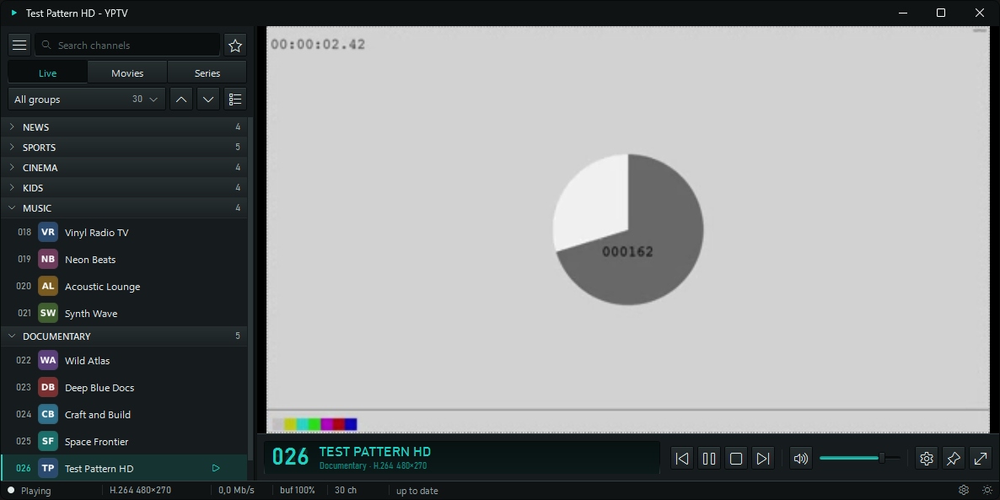

<p align="center"></p>

# YPTV

A small, fast IPTV player for Windows 11. Native WPF and LibVLC, no web view.



## Features
- Opens M3U / M3U8 playlists from a file or URL, drag and drop, or the command line (`YPTV.exe list.m3u`)
- Cached playlists: instant start, background refresh
- Live, Movies and Series scopes, groups, debounced search, favorites
- Several playlists with quick switching, Xtream login and account info, export to .m3u
- Dark, Light, AMOLED and System themes
- Audio / subtitle / aspect / deinterlace options, automatic reconnect for live streams
- Fullscreen, mini mode, always on top, hotkeys (F1 shows the list)

## Hotkeys

| Key | Action |
| --- | --- |
| Up / Down | Previous / next channel |
| 0-9, Enter | Jump to a channel number |
| Left / Right | Collapse / expand the group in the list |
| Space | Play / pause |
| M | Mute |
| J / L | Seek -10 s / +10 s (movies, series) |
| B | Next audio track |
| V | Next subtitle track, then off |
| A | Next aspect mode |
| D | Deinterlace on / off |
| F11 | Fullscreen |
| Esc | Leave fullscreen, cancel number entry |
| Ctrl+M | Mini mode |
| Ctrl+T | Always on top |
| Ctrl+, | Settings |
| F1 | This list |

## Install

Download a zip from Releases and extract it anywhere writable (the app creates its LibVLC plugin cache beside the exe on first run).

- `YPTV-win-x64.zip`: self-contained, nothing else needed.
- `YPTV-win-x64-fdd.zip`: smaller, needs the [.NET 8 Desktop Runtime](https://dotnet.microsoft.com/download/dotnet/8.0).

The exe is unsigned, so Windows SmartScreen may warn on first start ("More info", "Run anyway"). There is no installer and no file association: to open a playlist from Explorer use "Open with" and pick `YPTV.exe`.

## Build

Requires Windows 10/11 and the .NET 8 SDK.

```powershell
dotnet build src/Yptv -c Release
dotnet run --project src/Yptv
```

Release builds (what `.github/workflows/release.yml` runs on a `v*` tag):

```powershell
dotnet publish src/Yptv -c Release -r win-x64 --self-contained -p:PublishSingleFile=true -p:DebugType=none -o publish/YPTV-win-x64
dotnet publish src/Yptv -c Release -r win-x64 --self-contained false -p:PublishSingleFile=true -p:DebugType=none -o publish/YPTV-win-x64-fdd
```

## Performance

Measured with a synthetic 224,540-entry playlist (7,277 live), framework-dependent build:

| State | Working set | Private |
| --- | --- | --- |
| Window shown | 82 MB | 28 MB |
| LibVLC ready, idle | 103 MB | 35 MB |
| Live scope open | 128 MB | 45 MB |
| Playing a stream, 60 s | 150 MB | 67 MB |

Cold start to a visible window is about 0.3 s.

## Legal

YPTV is only a player. It contains no channels, playlists or streams, and you must only play content you have the right to access. Xtream account info only talks to the server of your own playlist.

## License

MIT, see [LICENSE](LICENSE). Third-party components: [THIRD-PARTY-NOTICES.md](THIRD-PARTY-NOTICES.md).
